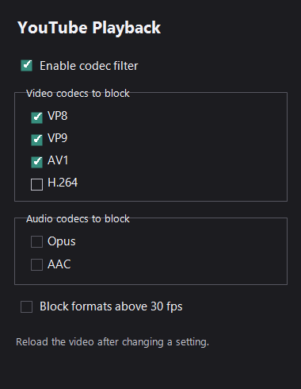

# Fluid for YouTube

**Created by xCC** · Firefox 140+ desktop / 142+ Android · Version 1.3.1 · [MIT license](LICENSE)

Fluid for YouTube is a Firefox extension designed to help older PCs browse YouTube more comfortably while keeping its familiar interface. It reduces some off-screen rendering work, gives visible thumbnails a head start, and lets you favor H.264 playback.

I tested it on an Intel Core i3 2nd generation PC with 12 GB of DDR3 memory and a SATA SSD. YouTube feels much smoother on my old PC. Results can vary depending on the PC, graphics hardware, browser, network and YouTube page.

## What changes when you use it?

| When you… | What the extension does |
| --- | --- |
| Scroll through a long playlist | Lets Firefox postpone drawing faraway entries until you get closer. It also works with supported layouts in search, recommendations, comments and Shorts shelves. |
| Open a page of videos | Asks Firefox to connect to YouTube’s thumbnail server early and prioritize up to four visible thumbnails that are still loading. The images keep their original resolution. |
| Play a video | Favors H.264 by default. This can help on an older PC whose graphics chip decodes H.264 in hardware. Audio and 60 fps playback are allowed by default. |

## Install from this repository

1. On GitHub, choose **Code → Download ZIP** and extract the archive. If you already cloned the repository, use that folder.
2. In Firefox 140 or later, open `about:debugging#/runtime/this-firefox` and click **Load Temporary Add-on…**.
3. Select **`src/manifest.json`** from the extracted folder, then refresh your YouTube tabs.

This installation lasts until Firefox restarts. If you have a dedicated H.264 extension enabled, disable it before using the built-in codec filter.

## Rebuild the extension for review

The JavaScript, HTML, and CSS files in `src/` are the readable source files used by the extension. The build does not transpile, concatenate, minify, or otherwise transform them. The build script only places those files and the MIT license into the extension ZIP. Some source code was written with assistance from OpenAI ChatGPT; no AI service or network connection is used when building or running the extension.

### Build environment

- Windows, macOS, or Linux
- Python 3.8 or later
- No third-party Python packages or network downloads are required

### Build steps

1. Extract this source archive.
2. Open a terminal in the `fluide-pour-youtube` folder (the folder containing `build.py`).
3. Run `python build.py` (on some systems, use `python3 build.py`).
4. The script creates `dist/Fluid-for-YouTube.zip`. Its contents match the extension package: files from `src/` at the archive root, plus `LICENSE`.

On Windows, `build.ps1` is also provided and can be run from PowerShell with `./build.ps1`.

## Choose your playback settings

Open **Fluid for YouTube** from Firefox’s Extensions menu. **A checked codec is blocked.** To favor H.264, leave H.264 unchecked and keep VP8, VP9 and AV1 checked. The screenshot shows the default settings in the extension’s English interface.

Refresh the video after changing a setting. To see what YouTube actually selected, right-click the video, open **Stats for nerds**, and look at **Codecs**. A video codec starting with `avc1` indicates H.264. If a video or resolution becomes unavailable, turn off **Enable codec filter** and reload. The navigation improvements still apply.

## Privacy

Your preferences stay in Firefox. The extension has no analytics and sends no usage reports. The early thumbnail connection goes directly to YouTube’s image server.

[Read the technical guide →](docs/TECHNICAL.md) · [View the source →](src/manifest.json)

## License and credits

**Fluid for YouTube was created by xCC** and is distributed under the [MIT License](LICENSE). You can use, modify and redistribute it, including commercially, provided you keep the copyright and permission notices.

The codec filter is adapted from [enhanced-h264ify by alextrv](https://github.com/alextrv/enhanced-h264ify), a fork of [h264ify by erkserkserks](https://github.com/erkserkserks/h264ify). Their [original MIT notice](src/LICENSE-enhanced-h264ify.txt) is included in the extension package.
